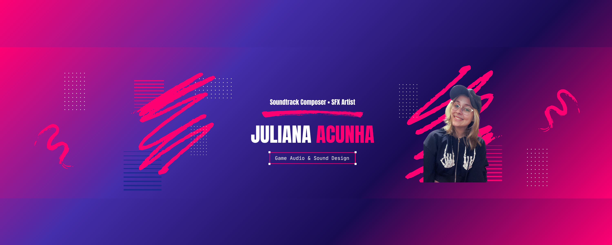
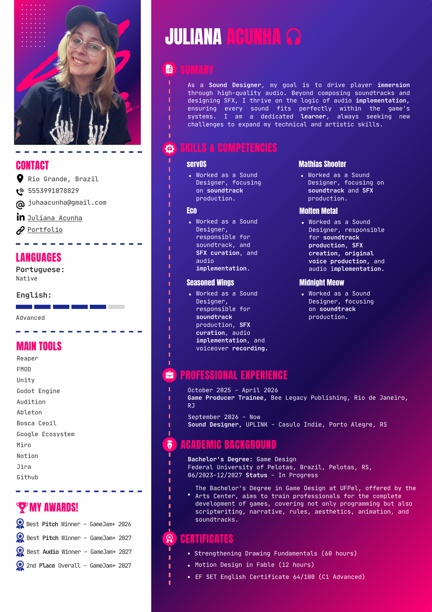
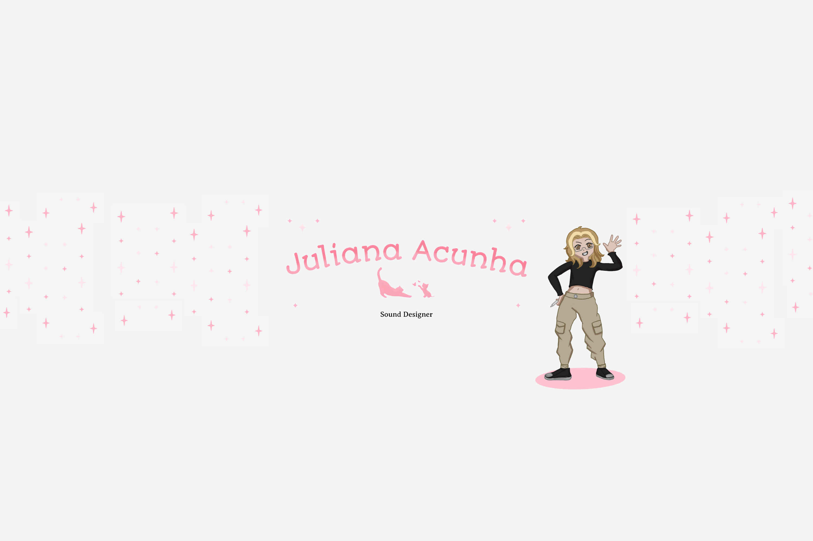

# Identidade visual — análise do material existente

> Base para o futuro `DESIGN.md` e os tokens do site. Cores medidas por quantização dos pixels do banner do Notion (3000×1200) e do currículo em PDF; fontes lidas com `pdffonts` no PDF.

## Duas identidades no material

| | **A — "Game Audio" (atual)** | **B — "Fofa" (antiga)** |
| --- | --- | --- |
| Onde aparece | Banner do Notion, currículo PDF (nov/2026) | Duas capas antigas do Notion, ícones de gatos nas subpáginas |
| Fundo | Gradiente diagonal índigo → roxo → magenta | Off-white com brilhos rosa |
| Tipografia | Anton (títulos), JetBrains Mono (texto) | Script arredondada rosa |
| Elementos | Rabiscos de pincel magenta, retícula de pontos, listras horizontais, linhas tracejadas, colchetes de seleção | Estrelinhas de quatro pontas, silhuetas de gatos, avatar ilustrado acenando |
| Tom | Enérgico, "estúdio de áudio", gamer | Fofo, acolhedor |

**Recomendação:** a identidade **A** é a atual e a que ela escolheu para o currículo; ela é a base. Da **B**, aproveitar pontualmente o que é dela e reforça a personalidade (gatos, que aparecem em Purr-Anormal, Midnight Meow, Feed The Cats; o avatar ilustrado em um 404 ou no rodapé). **(confirmar)** com ela.

## Paleta (identidade A)

| Papel | Hex | Origem |
| --- | --- | --- |
| Rosa-choque (acento principal) | `#F80070` | Pixel vívido mais frequente no banner: pinceladas, "ACUNHA", ícones e títulos do CV |
| Magenta escuro | `#DA0677` / `#9C096D` | Lado direito do gradiente |
| Roxo | `#971A92` | Meio do gradiente |
| Índigo médio | `#482AA1` | Centro do gradiente |
| Índigo | `#2A1B75` | Fundo predominante |
| Índigo profundo | `#1D0F5A` | Fundo mais escuro (bom para fundo de página) |
| Ameixa | `#450B5C` | Transição índigo → magenta |
| Branco | `#FFFFFF` | Texto sobre o gradiente, coluna lateral do CV |
| Azul royal (secundário) | ~`#2E2A8F` | Linhas tracejadas e barras de idioma na coluna branca do CV |

O gradiente vai, em diagonal, de rosa-choque (canto superior esquerdo) para índigo (centro) e volta para magenta (canto inferior direito).

### Contraste (WCAG, calculado)

| Combinação | Razão | Uso permitido |
| --- | --- | --- |
| Branco sobre `#1D0F5A` | 16,6:1 | Qualquer texto |
| Branco sobre `#2A1B75` | 13,9:1 | Qualquer texto |
| `#F80070` sobre `#1D0F5A` | 4,1:1 | Só texto grande (≥ 24 px, ou ≥ 18,7 px negrito) e elementos gráficos |
| `#F80070` sobre `#2A1B75` | 3,5:1 | Só texto grande e elementos gráficos |
| Branco sobre `#F80070` | 4,0:1 | Só texto grande (botões com texto grande/negrito) |
| `#FF4D9A` sobre `#1D0F5A` | 5,4:1 | Texto pequeno — variante clara do rosa para links e rótulos |
| `#FF5CA3` sobre `#2A1B75` | 4,8:1 | Texto pequeno |

Conclusão: o rosa original fica para títulos em Anton (sempre grandes), pinceladas e botões; links e textos pequenos em rosa usam uma variante mais clara (~`#FF4D9A`).

## Tipografia

| Uso | Fonte | Observação |
| --- | --- | --- |
| Títulos, nome, seções | **Anton** (Regular, caixa alta) | Condensada, impacto; disponível no Google Fonts (OFL) |
| Texto, rótulos, metadados | **JetBrains Mono** (Regular e Bold) | Dá o ar "técnico/áudio"; Google Fonts (OFL) |
| Apoio | Source Sans Pro Bold (Source Sans 3) | Aparece pouco no PDF; pode ser a fonte de corpo se o mono cansar em parágrafos longos |

No banner, o subtítulo "Soundtrack Composer • SFX Artist" usa uma sans condensada em negrito e "Game Audio & Sound Design" usa mono dentro de uma caixa com alças de seleção (estilo Canva/Figma).

## Elementos gráficos reutilizáveis

- **Rabiscos de pincel** rosa-choque atrás da foto e soltos nas laterais. Podem virar SVGs decorativos (desenhados de novo, não recortados do banner).
- **Retícula de pontos** brancos em blocos retangulares.
- **Listras horizontais** finas (rosa ou azul) em blocos.
- **Linha tracejada vertical** com ícones circulares rosa — a "timeline" do CV. Ótima para experiência/formação.
- **Caixa com alças de seleção** (quatro quadradinhos nos cantos) em volta de rótulos — referência à interface de software, combina com "sound designer trabalhando numa DAW".
- **Ícone de fone de ouvido** ao lado do nome (CV) e como ícone da página no Notion (`headphones_pink`).
- Ícones dos projetos no Notion: gato rosa (Purr-Anormal), livro verde (Hands Off), martelo amarelo (Molten Metal), robô cinza (ServOS), borboleta amarela (Seasoned Wings), gato roxo (Midnight Meow), tartaruga verde (Mathias Shooter), pessoa azul (Eco), gato amarelo (Feed The Cats).

## Linguagem visual sugerida para o site (a validar)

- Fundo escuro índigo profundo com seções alternando um gradiente sutil índigo → magenta.
- Áudio como protagonista visual: **formas de onda** reais dos arquivos (geradas no build) nos cards de SFX, em vez de ícones genéricos; play com destaque rosa.
- O reel do YouTube no hero, como no Notion, mas com fachada leve.
- Títulos em Anton caixa alta, metadados em JetBrains Mono (engine, papel, duração, BPM/tonalidade quando houver: Seasoned Wings em Dó maior, Mathias Shooter em Mi maior).

## Ativos visuais disponíveis

| Ativo | Arquivo local | Notas |
| --- | --- | --- |
| Banner com foto | `.scratch/assets/banner-NboJ6VK.png` | 3000×1200, foto já recortada |
| Foto recortada | `.scratch/assets/foto-jSD9c9g.jpeg` | Fundo removido com IA |
| Avatar ilustrado | `.scratch/assets/2c57d106-Background_Notion_(5).png`, `2fc7d106-Background_Notion_(3).png` | Embutido em capa; para usar isolado, pedir o arquivo original |
| Imagem de prévia social do Notion | URL `SocialMediaPreviewImage.png` no Notion | Não baixada |
| Capas dos 9 projetos | `.scratch/assets/*capa*`, etc. | 1024 px |

Faltam: logotipo/monograma (se houver), arquivos-fonte dos rabiscos (Canva) e o avatar ilustrado em PNG transparente.
