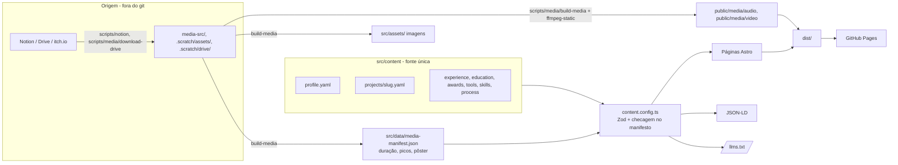

# Design técnico — Site Portfólio da Juliana Acunha

Fase 2 do Spec-Driven Development. Stack em [ADR-001](../decisions/ADR-001-stack-e-hospedagem.md); visual em [DESIGN.md](../design/DESIGN.md); requisitos em [requirements.md](requirements.md). Este documento descreve a v1 como implementada.

## Arquitetura



A mídia processada (`public/media/`, `src/assets/`, manifesto) é versionada; o CI não roda `npm run media`. Os originais ficam fora do git.

## Estrutura de pastas

```
/
├─ AGENTS.md
├─ astro.config.mjs           # site + base vindos de env (raiz ou subcaminho)
├─ .github/workflows/deploy.yml
├─ .cursor/rules/, .cursor/skills/
├─ docs/
├─ media-src/                 # originais adicionados à mão (gitignored)
├─ public/
│  ├─ media/audio/<projeto>/<id>.mp3
│  ├─ media/video/<grupo>/<id>.mp4 + .jpg (pôster)
│  ├─ cv/juliana-acunha.pdf
│  ├─ docs/<projeto>-*.pdf
│  ├─ og.jpg, favicon.svg
├─ scripts/
│  ├─ notion/                 # captura do Notion
│  ├─ media/sources.mjs       # curadoria: chave → arquivo de origem
│  ├─ media/build-media.mjs   # converte, gera picos/pôsteres, copia imagens, escreve o manifesto
│  ├─ media/download-drive.mjs
│  ├─ screens.mjs             # capturas 390/1280 px em .scratch/shots/
│  └─ check-tokens.mjs        # barra cores literais fora de tokens.css
├─ tests/e2e/                 # Playwright + axe
└─ src/
   ├─ content.config.ts
   ├─ content/                # profile, experience, education, awards, tools, skills, process (.yaml)
   │  └─ projects/<slug>.yaml
   ├─ data/media-manifest.json
   ├─ assets/brand/           # foto, avatar, gatos
   ├─ assets/projects/<slug>/ # capa e galeria
   ├─ assets/awards/, assets/youtube/ (thumbnails baixadas no build de mídia)
   ├─ i18n/index.ts           # locales, localize, url, projectPath
   ├─ i18n/ui.ts              # rótulos de interface pt/en
   ├─ lib/                    # content, images, media, jsonld, taxonomy
   ├─ styles/tokens.css, global.css
   ├─ components/
   │  ├─ layout/              # SiteHeader, SiteFooter
   │  ├─ sections/            # Hero, Reel, Featured, SoundBoard, ProjectGrid, ProjectCard, Process, About, Contact
   │  ├─ ui/                  # SoundCard, YouTubeFacade, SoundCloudFacade, LocalVideo, SectionHeading, Decor
   │  ├─ islands/             # AudioEngine, FilterBar
   │  ├─ HomePage.astro, ProjectPage.astro
   ├─ layouts/BaseLayout.astro
   └─ pages/
      ├─ index.astro, projetos/[slug].astro          # PT-BR
      ├─ en/index.astro, en/projects/[slug].astro    # EN
      ├─ 404.astro, robots.txt.ts, llms.txt.ts
```

## Rotas

| Rota | Conteúdo | Requisitos |
| --- | --- | --- |
| `/` | Home PT-BR: hero, reel, destaques, sound board, projetos, processo, sobre, contato | R-01..R-09 |
| `/projetos/[slug]/` | Estudo de caso PT-BR | R-10, R-11 |
| `/en/`, `/en/projects/[slug]/` | Espelho EN | R-14 |
| `/cv/juliana-acunha.pdf` | CV do Canva | R-15 |
| `/llms.txt`, `/robots.txt`, `/sitemap-index.xml` | Máquina | R-22, R-23 |
| `/404.html` | Página de erro (noindex) | R-16 |

Âncoras da home: `#reel`, `#sounds`, `#projects`, `#process`, `#about`, `#awards`, `#contact`.

## Modelo de conteúdo

Fonte de verdade: [`src/content.config.ts`](../../src/content.config.ts). Textos localizados são `{ pt, en }` (objeto estrito: chave extra quebra o build); listas localizadas exigem o mesmo número de itens nos dois idiomas. Datas em `AAAA-MM`.

| Coleção | Campos principais |
| --- | --- |
| `profile` | name, label\*, tagline\*, intro\*, summary\*, location\*, email, phone {display, href}, reel (YouTube), cv, opportunities\*[], profiles[], languages[] |
| `experience` | order, organization, position\*, location\*, startDate, endDate?, summary\*? |
| `education` | order, kind (degree \| certificate), institution?, title\*, detail\*?, startDate?, inProgress |
| `awards` | order, title\*, edition, stage\*, project (ref), image, imageAlt\*, highlight |
| `tools` | order, group\*, items[] |
| `skills` | order, kind (hard \| soft), title\*, text\* |
| `process` | order, video (chave do manifesto), title\*, project (ref)? |
| `projects` | ver abaixo |

`projects/<slug>.yaml`: title, altTitle\*?, hook\*, synopsis\*, genre\*?, engine (Unity \| Godot \| Pyxel), context\*, studio?, year?, status (released \| in-development \| prototype \| on-hold), deliverables[] (enum em `lib/taxonomy.ts`), role\*, soundNotes\*[]?, team[] {name, role\*?}, noGenerativeAi, links {itch?, soundcloud?, playable}, cover, coverAlt\*, tracks[] {audio, title\*, curated}, sfx[] {audio, label\*, category, curated}, stems[] {audio, label\*}, videos[] {kind, title\*, youtube? \| local?}, gallery[] {image, alt\*}, docs[] {title\*, file}, featured, order, draft.

Categorias de SFX: `foley`, `ui`, `voice`, `chiptune`, `gameplay`. `curated: true` marca som de terceiros selecionado/mixado por ela: aparece com o selo "curadoria" e fica fora do sound board.

### Checagens no build

- Toda chave `audio`/`video`/`local` existe em `media-manifest.json`.
- Referências `project` de prêmios e processo existem.
- Imagens resolvem em `src/assets/` (falha no build se faltar).

## Pipeline de mídia (`npm run media`)

1. `scripts/media/sources.mjs` mapeia cada chave para o final do nome do arquivo de origem, procurado em `media-src/`, `.scratch/assets/` e `.scratch/drive/` (o casamento precisa ser único).
2. Áudio: MP3 160 kbps; 64 picos a partir de PCM 8 kHz; duração.
3. Vídeo: H.264 CRF 30, lado maior ≤ 1280 px, AAC 128 kbps, `faststart`; `cropdetect` remove tarjas pretas; pôster JPG.
4. Imagens e PDFs são copiados; `og.jpg` (1200×630) sai do banner; thumbnails do YouTube são baixadas para `src/assets/youtube/`.
5. Idempotente por data de modificação (`--force` refaz tudo). Sem normalização de loudness na v1.

## Interatividade

| Peça | Função |
| --- | --- |
| `AudioEngine` | Um `<audio>` compartilhado; cards `[data-sound]` só trocam `src`. Clique na onda faz seek; ←/→ ±5 s; `aria-pressed` e rótulo alternam; erro de carregamento volta o card ao estado inicial. Vídeos e fachadas pausam o áudio (`ja:media-start`) |
| Fachadas YouTube/SoundCloud | Script inline mínimo troca o botão pelo iframe no clique |
| `FilterBar` | Filtra `[data-tags]` dentro de `[data-filter-scope]`; oculto sem JS (todos aparecem) |

Sem JS: cada card tem `<noscript><audio controls>`; vídeos usam `<video controls>`.

## Base path e i18n

- `astro.config.mjs` lê `SITE` e `BASE` do ambiente. Links internos sempre via `url()`, que prefixa `import.meta.env.BASE_URL`. No CI, `<dono>.github.io` publica na raiz e qualquer outro repositório em `/<repo>/`.
- i18n do Astro: `locales: ['pt-br', 'en']`, `defaultLocale: 'pt-br'`, `prefixDefaultLocale: false`; slugs de página traduzidos (`projetos` / `projects`), slugs de projeto iguais nos dois idiomas.

## Verificação (CI)

```
npm run check     # astro check + eslint + prettier --check + check:tokens
npm run build
npm test          # Playwright + axe contra o build (390 px e 1280 px)
npm run verify    # tudo acima
```

O CI repete build e testes com `BASE=/teste/`. Testes específicos deste site:

- Nenhum `<iframe>` no HTML inicial (R-13); fachada do YouTube cria o iframe só no clique.
- Tocar um som e depois outro: só um toca (R-03, R-12). Filtro do sound board.
- Sem JS: `<audio controls>` presente com `src` válido (N-08).
- Toda mídia do manifesto existe e respeita os limites de tamanho (N-02).
- Termos de template do Notion ausentes; contato com e-mail, telefone e cidade; sons de curadoria fora do sound board; stems do Midnight Meow; créditos de equipe.

GitHub Actions: `verify` em todo push/PR; `build` + `deploy` para Pages só em `main` e só se `verify` passar.
