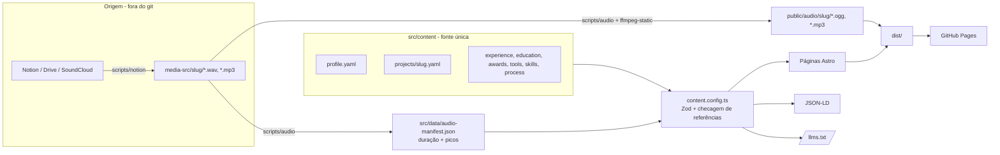

# Design técnico — Site Portfólio da Juliana Acunha

Fase 2 do Spec-Driven Development. Stack em [ADR-001](../decisions/ADR-001-stack-e-hospedagem.md); visual em [DESIGN.md](../design/DESIGN.md); requisitos em [requirements.md](requirements.md).

## Arquitetura



## Estrutura de pastas planejada

```
/
├─ AGENTS.md
├─ astro.config.mjs           # site + base vindos de env (raiz ou subcaminho)
├─ package.json
├─ docs/
├─ media-src/                 # originais de áudio por projeto (gitignored)
├─ public/
│  ├─ audio/<slug>/<id>.ogg|.mp3   # gerados e versionados
│  ├─ cv/juliana-acunha.pdf
│  ├─ docs/<slug>-one-page.pdf
│  ├─ robots.txt, favicon.svg, og.png
├─ scripts/
│  ├─ notion/                 # captura do Notion (já existe)
│  ├─ audio/build-audio.mjs   # converte + gera manifest
│  └─ check-tokens.mjs        # barra cores literais fora de tokens.css
├─ tests/e2e/                 # Playwright + axe (R-xx nos nomes)
├─ .cursor/rules/, .cursor/skills/
└─ src/
   ├─ content.config.ts
   ├─ content/
   │  ├─ profile.yaml
   │  ├─ experience.yaml
   │  ├─ education.yaml       # cursos + certificados
   │  ├─ awards.yaml
   │  ├─ tools.yaml
   │  ├─ skills.yaml
   │  ├─ process.yaml         # vídeos de foley
   │  └─ projects/<slug>.yaml
   ├─ data/audio-manifest.json
   ├─ assets/projects/<slug>/ # capa, screenshots, processo (astro:assets)
   ├─ assets/brand/           # foto, avatar, SVGs de pincel/retícula
   ├─ i18n/                   # ui.ts (strings de interface), index.ts (localize, url)
   ├─ styles/tokens.css, global.css
   ├─ components/ui/, sections/, layout/, islands/
   ├─ layouts/BaseLayout.astro
   ├─ lib/jsonld.ts, lib/audio.ts
   └─ pages/
      ├─ index.astro                 # EN
      ├─ projects/[slug].astro       # EN
      ├─ pt/index.astro              # PT-BR
      ├─ pt/projetos/[slug].astro    # PT-BR
      ├─ cv/ (PDF em public/)
      ├─ llms.txt.ts
      ├─ 404.astro
      └─ dev/tokens.astro, dev/conteudo.astro   # noindex
```

## Rotas

| Rota | Conteúdo | Requisitos |
| --- | --- | --- |
| `/` | Home EN: hero com reel, destaques, sound board, projetos, processo, conquistas, experiência e formação, ferramentas e skills, contato | R-01..R-09 |
| `/projects/[slug]` | Estudo de caso EN | R-10, R-11, R-21 |
| `/pt/`, `/pt/projetos/[slug]` | Espelho PT-BR | R-14 |
| `/cv/juliana-acunha.pdf` | CV do Canva | R-15 |
| `/llms.txt` | Resumo para IA | R-22 |
| `/404` | Página de erro | R-16 |
| `/dev/tokens`, `/dev/conteudo` | Verificação interna (noindex, fora do sitemap) | — |

Âncoras da home: `#work` (sound board), `#projects`, `#process`, `#awards`, `#experience`, `#tools`, `#contact`.

## Modelo de conteúdo

Campos marcados com \* são localizados: `{ en: string, pt: string }`. Datas em `AAAA-MM`. `draft: true` não publica.

### `profile.yaml`

```yaml
name: Juliana Acunha
label*: Sound Designer
tagline*: Soundtrack Composer · SFX Artist
summary*: ...
location*: Rio Grande, RS, Brazil         # (confirmar)
email: juhaacunha@gmail.com
phone: { value: '+55 53 99107-8829', public: false }
reel: { youtube: JByBcjKhWck }
cv: /cv/juliana-acunha.pdf
profiles:
  - { network: SoundCloud, url: https://soundcloud.com/juliana-acunha-232828507 }
  - { network: itch.io, url: https://ju-acunha.itch.io/ }
  - { network: YouTube, url: https://www.youtube.com/@JubssAcunha }
  - { network: LinkedIn, url: https://www.linkedin.com/in/juliana-acunha-01a39a293/ }
languages: [{ name*, level*, note }]
```

### `projects/<slug>.yaml`

```yaml
id: molten-metal
title: Molten Metal
altTitle*: ~                    # ex.: Asas Temperadas: Receitas Mágicas
hook*: ...                      # uma linha (card)
synopsis*: ...
genre*: Rhythm · Clicker · Roguelite
engine: Godot                   # Godot | Unity | Pyxel
platforms: [Windows]
context:
  kind: jam                     # jam | university | studio | solo | personal
  name*: GameJam Plus 2026/27
  detail*: ~                    # ex.: "UFPel — Projeto Integrado V"
year: 2026
status: released                # released | in-development | prototype | on-hold
deliverables: [soundtrack, sfx, voice, implementation]
  # enum: soundtrack, sfx, voice, curation, mixing, implementation,
  #       game-design, writing, ui, art, animation, 3d, programming, documentation
role*: ...                      # texto dela
soundNotes*: [ ... ]            # "intenção sonora" (callouts do Notion)
team: [{ name, role*? }]        # créditos (confirmar permissão)
awards: [best-audio-gjp-2627]   # ids de awards.yaml
noGenerativeAi: true
links: { itch: https://madsilvax.itch.io/moltenmetal }
soundcloud: https://soundcloud.com/juliana-acunha-232828507/sets/molten-metal
tracks:   [{ audio: molten-metal/menu, title*: Menu Theme }]
sfx:      [{ audio: molten-metal/martelada-perfect, label*: Perfect hammer hit, category: foley }]
voice:    [{ audio: molten-metal/vitoria-tinindo, label*: Victory line }]
stems:    [{ audio: midnight-meow/01-batida, label*: Beat, order: 1 }]   # só Midnight Meow
videos:   [{ kind: teaser, youtube: pNarBwwvbPE, title*: Teaser }]
          # kind: reel | teaser | pitch | process; youtube | drive (id)
images:   [{ src: ./molten-metal/cover.png, alt*: ..., role: cover }]
docs:     [{ title*: One Page, file: /docs/eco-one-page.pdf }]
featured: true
order: 1
draft: false
```

Categorias de SFX: `foley`, `ui`, `voice`, `chiptune`, `gameplay`, `ambience`.

### Demais coleções

| Coleção | Campos principais |
| --- | --- |
| `experience` | organization, position\*, location\*, startDate, endDate?, summary\*?, highlights\*[] (vazio até confirmação), url? |
| `education` | institution, shortName, area\*, studyType\*, startDate, endDate (confirmar D1), status; `certificates[]`: name\*, hours?, score? |
| `awards` | id, title\*, edition, stage\* ("Regional stage"), project (ref), image, text\*?, date? |
| `tools` | group\* (Audio, Engines, Production, Art & 3D), items[] { name, icon } |
| `skills` | group\* (Hard, Soft), items[] { title\*, text\* } |
| `process` | videos[] { drive \| youtube, title\*, caption\*, project? } |

### Checagens no build (`content.config.ts`)

- Toda referência `audio: <slug>/<id>` existe em `audio-manifest.json`.
- Todo `awards[]` de projeto existe em `awards.yaml`; todo `award.project` existe.
- Todo campo localizado tem `en` e `pt` não vazios (exceto em `draft`).
- `phone.public` só pode ser `true` com flag explícita (evita exposição acidental).

## Pipeline de áudio (`scripts/audio/build-audio.mjs`)

1. Lê `media-src/<slug>/*.{wav,mp3}`; o id é o nome do arquivo normalizado (`martelada_perfect.wav` → `martelada-perfect`).
2. Com `ffmpeg-static`: normaliza loudness (EBU R128, −16 LUFS para trilhas, −18 para SFX, sem alterar arquivos que já estejam dentro de ±1 LU — **(confirmar)** com ela se pode normalizar), gera `.ogg` (Opus 96 kbps) e `.mp3` (128 kbps).
3. Extrai ~120 picos (RMS por janela) e a duração → `src/data/audio-manifest.json`.
4. Idempotente: só reprocessa arquivos novos ou alterados (hash).

Os originais vêm de `.scratch/assets/` (anexos do Notion) e do Google Drive (a baixar).

## Interatividade

| Ilha | Carregamento | Função |
| --- | --- | --- |
| `AudioPlayer` | `client:visible` | Um `<audio>` compartilhado por página; cards só trocam `src` e estado. Teclado: Espaço/Enter play-pause, setas ±5 s. Evento `ja:play` garante um som por vez |
| Fachadas (YouTube/SoundCloud/Drive) | Script inline mínimo | Troca o botão pelo iframe no clique |
| Filtros (sound board, projetos) | `client:visible` | Filtra por `data-*`; sem JS, todos aparecem |

Todo o resto é HTML/CSS estático.

## Base path e i18n

- `astro.config.mjs` lê `SITE` e `BASE` do ambiente (`https://usuario.github.io` e `/` ou `/repo/`). Links internos sempre via helper `url()` que prefixa `import.meta.env.BASE_URL`. Testes rodam com `BASE=/teste/` para garantir que nada quebra em subcaminho.
- i18n do Astro: `locales: ['en', 'pt']`, `defaultLocale: 'en'`, `prefixDefaultLocale: false`; slugs de página traduzidos (`projects` / `projetos`), slugs de projeto iguais nos dois idiomas.

## Verificação (CI)

Igual ao site do Pedro:

```
npm run check     # astro check + eslint + prettier --check + check:tokens
npm run build
npm test          # Playwright + axe contra o build (390 px e 1280 px), também com BASE=/teste/
npm run verify    # tudo acima
```

Testes específicos deste site:

- Nenhum `<iframe>` no HTML inicial de nenhuma página (R-13, N-01).
- Clicar em play num SFX toca; clicar em outro pausa o primeiro (R-03, R-12).
- Sem JS: `<audio controls>` presente e com `src` válido (N-08).
- Telefone ausente do HTML enquanto `phone.public: false` (N-09).
- Todos os arquivos referenciados em `public/audio` existem e têm ≤ 2 MB (N-02).
- Termos de template proibidos ausentes (ex.: "Scikit-learn", "85% de acurácia").

GitHub Actions: `verify` em todo push/PR; `build` + `deploy` para Pages só em `main` e só se `verify` passar. O workflow fica pronto mas desligado até a decisão da conta (pergunta 19).
